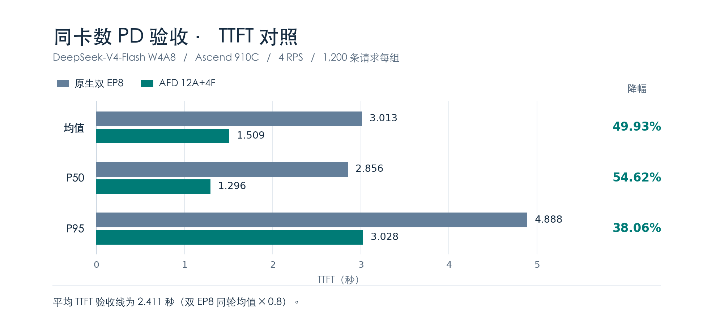

# AFD Performance Acceptance

这是 `DeepSeek-V4-Flash W4A8` 在 Ascend 910C 上的 Prefill 异步 A/F 分离验收案例。`2026-11-23` 的正式对照使用两台 910C、共 32 DIE，PD 入口实发 4 RPS。AFD 12A+4F 的平均 TTFT 从双 EP8 的 **3.013 秒**降至 **1.509 秒**，降低 **49.93%**。

## 复算已有结果

普通机器上只需 Python 3.9+ 和 Bash。脚本从公开的逐请求记录、KV 关联和运行计数复算结果。

~~~bash
./reproduce.sh --verify-reference
~~~

[正式报告](results/2026-11-23/README.md) · [公开逐请求证据](results/2026-11-23/evidence/) · [验收标准](docs/acceptance.md)

## 上机复测

在两台各有 16 DIE 的 Ascend 910C 上启动匹配的容器，并在两端挂载同一 W4A8/DSpark checkpoint。将仓库放到两端可读写的共享目录，再按 [910C 复测步骤](docs/reproduce-910c.md)配置节点接入方式。

~~~bash
cp site.env.example site.env
./reproduce.sh --site site.env
~~~

入口核对镜像中的源码版本和权重指纹，从本仓 Release 校验并获取冻结负载，从公开源码准备 AFD 和 CWS，然后执行 PD 冒烟、双 EP8 资格试跑、两组正式回放和 8A+8F 功能验证。最后写出 `runs/<run-id>/acceptance.json` 和各组运行证据。

[固定配置](cases/910c-dsv4-w4a8-rps4/config.env) · [版本和校验值](cases/910c-dsv4-w4a8-rps4/case.json) · [冻结负载清单](cases/910c-dsv4-w4a8-rps4/workload.json) · [数据来源与许可](cases/910c-dsv4-w4a8-rps4/DATASET.md)
