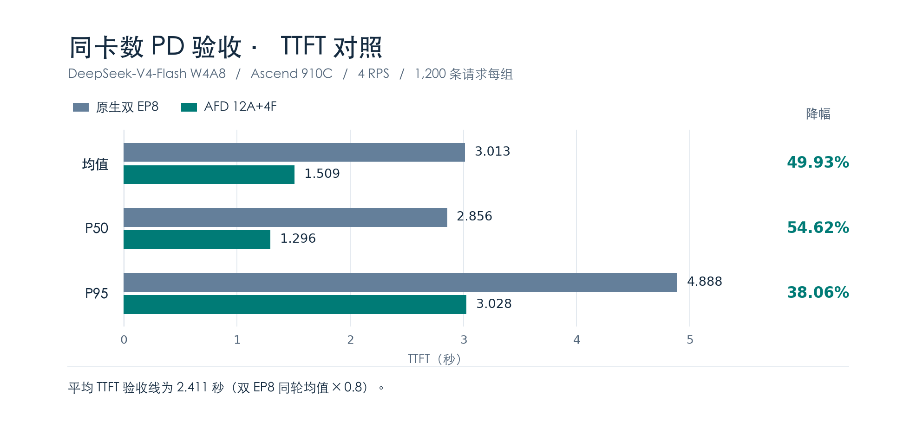

# 2026-11-23 · DeepSeek-V4-Flash W4A8 PD performance acceptance

**性能验收达标。** 冻结 WildChat 多轮负载后，双 EP8 平均 TTFT 为 **3.013 秒**，AFD 12A+4F 为 **1.509 秒**，降低 **49.93%**。在同轮双 EP8 基线下，20% 降幅对应的 TTFT 上限为 2.411 秒。

## 部署和负载

- 同一对 Ascend 910C 节点、共 16 张物理卡和 32 DIE，P/D 各占 16 DIE。DeepSeek-V4-Flash W4A8、vLLM 0.30.0、CANN 9.1.0，完整 PD，Prefix Cache OFF。
- 双 EP8 为两套 DP2TP4/EP8，MBT 8192、每 DP 8 序列。AFD 为 A DP6TP2、F DP4TP1/EP4，MBT 32768、每 DP 16 序列。A 启用原生双微批 DBO，F 走 Async CAM layered GMM Eager。P 都加载 CWS 和 Mooncake 逻辑页修复。
- D 共用 DP16TP1/EP16、MBT 120、每 DP 2 序列的配置，主模型 FULL_DECODE_ONLY，DSpark 5-token draft Eager。Producer 的 DP/TP 元数据随 P 配置更新。
- 200 个会话、400 条用于基线资格试跑。正式用另外 600 个会话、1,200 条请求，每会话保留相邻两轮与原始历史。正式输入均值 10,027 token，P95 26,695，最长 32,759。两组各预热同一份 16 条请求，正式固定每 250 毫秒发一条，经 PD proxy 生成 1 token。两组实际发送顺序完全一致。

[验收条件和计时方法](../../docs/acceptance.md) · [精确版本和负载指纹](../../cases/910c-dsv4-w4a8-rps4/case.json)

## 正式结果

| 指标 | 原生双 EP8 | AFD 12A+4F |
| --- | ---: | ---: |
| 成功请求 | 1,200/1,200 | 1,200/1,200 |
| 实发 RPS | 3.999995 | 3.999986 |
| 实际输入 token/s | 40,109.29 | 40,109.20 |
| **平均 TTFT（秒）** | **3.013** | **1.509** |
| P50 TTFT（秒） | 2.856 | 1.296 |
| P95 TTFT（秒） | 4.888 | 3.028 |
| P 初始等待均值（毫秒） | 366.177 | 0.041 |
| P Prefill 阶段均值（秒） | 2.007 | 1.154 |
| P 等待队列采样峰值 | 6 | 0 |
| D 侧匹配的 KV 传输 | 1,200 | 1,200 |
| D 外部 KV token 增量 | 12,031,604 | 12,031,604 |

双 EP8 资格试跑完成 400/400，P 初始等待均值 0.194 秒，P 等待峰值 2 条。正式回放中，过了启动窗口后，双 EP8 每 25 秒完成 94–104 条，采样窗口末在途在 7–16 条之间波动。P95 降低 38.06%。平均 TTFT 共缩短 1.505 秒，其中 P 初始等待减少 0.366 秒，P Prefill 阶段计时减少 0.853 秒。该降幅包含完整 P 部署的拓扑、MBT 和执行差异。 [成对复算结果](reference.json) · [输入长度分桶](paired-ttft-by-input-length.json)

## 实测范围

12A+4F 和 8A+8F 都通过异步 F worker、实际 native 库映射、跨节点 KV 和 8-token 生成验证。正式 1,200 条性能比较采用 12A+4F。正式输入选取 1,024–32,768 token，资格候选曾有一条 12-token 请求触发原生 P 的 CWS KV 导出断言。同一批正式请求全量完成单 token 生成，流式首 token 文本有 75 条差异，双 EP8 两次独立预热间有 1 条差异。 [首 token 文本统计](first-token-text-review.json)

原表记录的 8.7 秒是历史参照，本轮正式均值以冻结负载下的双 EP8 实测为分母。该批相同机器下的高压诊断另实测过 72,007 input token/s，双 EP8 初始等待 22.239 秒，初始队列显著影响了 TTFT 差值。

## 公开证据

`evidence/` 从两组原始运行投影出可复算字段，保留原始单调时钟值、输入输出计数、响应关联、KV 计数和队列。响应 ID 在客户端记录、预热和 Decode 成功传输之间使用同一个散列别名。`workload-index.jsonl.gz` 保留正式负载的 ID、会话、轮次、顺序和长度。根目录的 `./reproduce.sh --verify-reference` 从这些字段重新计算并校验报告。
